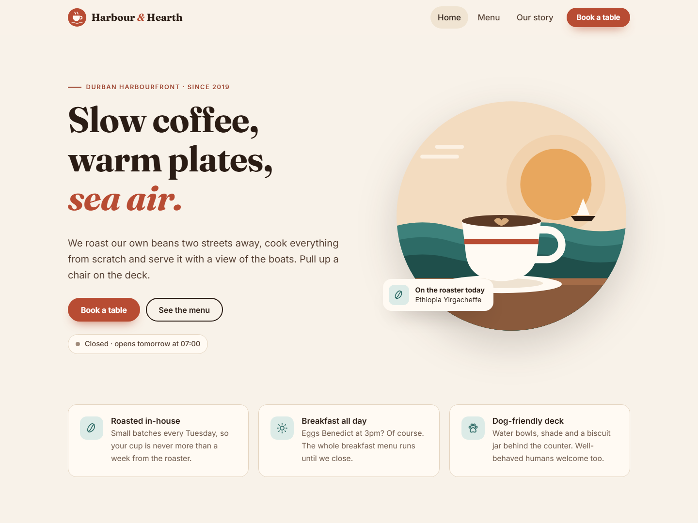
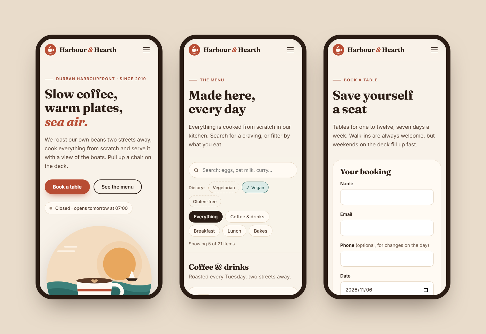

# Harbour & Hearth

A responsive, multi-page website for a fictional café on the Durban harbourfront. It's a portfolio project showing the kind of site a small hospitality business needs: a strong first impression, a searchable menu, live opening hours and online table bookings.





## Features

- **Four pages:** Home, Menu, Our story and Book a table, with a shared header, footer and mobile menu.
- **Live "open now" status:** works out whether the café is open from the visitor's clock, always in Durban time, and says when it next opens.
- **Searchable menu:** filter by section and by vegetarian, vegan or gluten-free (vegan counts as vegetarian), and search names and descriptions. Filters are kept in the URL, so a filtered menu can be shared as a link.
- **Table booking form:** time slots follow each day's opening hours, with a last seating an hour before close and no same-day slots less than 30 minutes away. Fields are validated inline with clear messages and a confirmation summary. This is a demo, so nothing is sent.
- **Responsive and accessible:** works from 320px phones up to wide screens. Includes a skip link, keyboard-friendly navigation, visible focus, labelled form errors, live-region updates and reduced-motion support.
- **Fast:** no framework and no images to download. The illustrations are inline SVG, each page loads only its own script, and the whole site is about 20 kB of CSS and 20 kB of JavaScript before compression.

## Built with

HTML, CSS and TypeScript, bundled with [Vite](https://vite.dev). Unit tests use [Vitest](https://vitest.dev). It deploys to GitHub Pages with GitHub Actions.

| File | What it does |
| --- | --- |
| `src/hours.ts` | Opening hours, café time and the open/closed status |
| `src/booking-rules.ts` | Booking slots and validation (pure functions, fully tested) |
| `src/booking.ts` | Wires the booking form to those rules |
| `src/menu-filter.ts` | Menu search and filtering, and reading/writing filters in the URL |
| `src/menu.ts` | Renders the menu and its controls |
| `src/data.ts` | Menu items, sections and dietary labels |
| `src/styles/main.css` | All styles, built on CSS custom properties |

## Run it locally

Needs Node.js 20 or later.

```bash
npm install
npm run dev
```

Then open http://localhost:5173.

```bash
npm test
```

```bash
npm run build
```

`npm run build` type-checks the project and writes the static site to `dist/`.

## Deploy

Push to the `main` branch of a GitHub repository, then under **Settings → Pages** set **Source** to **GitHub Actions**. The workflow in `.github/workflows/deploy.yml` runs the tests, builds the site and publishes it.

---

Harbour & Hearth is a fictional business: its names, address, phone number and reviews are made up for this demo. Designed and built by [Deshlan P.](https://www.upwork.com/freelancers/~0136f319881683d143)
